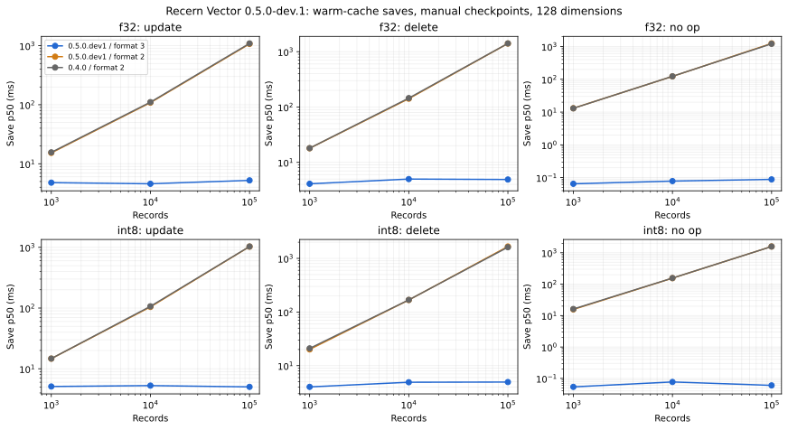
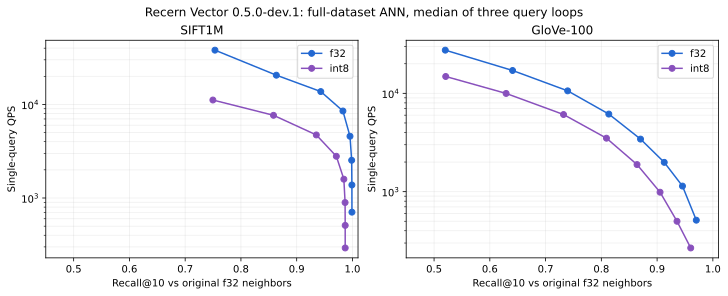

# Vector 0.5.0-dev.1 results

See [method, environment and commands](README.md). Save scheduling is disabled; these are warm-cache, single-process observations, not serving SLOs. Raw repetitions are retained.

## Persistence

Latency is save-only. Each cell is the median of three per-process medians; peak RSS includes the complete process and all benchmark phases.

| Records | Precision | Engine / format | Update p50 ms | Delete p50 ms | Clean-save p50 ms | Peak RSS MiB | Snapshot MiB |
|---:|---|---|---:|---:|---:|---:|---:|
| 1,000 | f32 | 0.4.0 / 2 | 15.604 | 18.066 | 13.007 | 111.9 | 0.6 |
| 1,000 | f32 | 0.5.0.dev1 / 2 | 15.287 | 17.974 | 13.081 | 112.5 | 0.6 |
| 1,000 | f32 | 0.5.0.dev1 / 3 | 4.784 | 4.102 | 0.065 | 61.0 | 3.9 |
| 1,000 | int8 | 0.4.0 / 2 | 14.721 | 20.990 | 16.187 | 155.8 | 0.3 |
| 1,000 | int8 | 0.5.0.dev1 / 2 | 14.680 | 20.097 | 15.706 | 155.9 | 0.3 |
| 1,000 | int8 | 0.5.0.dev1 / 3 | 5.105 | 4.021 | 0.054 | 56.5 | 3.9 |
| 10,000 | f32 | 0.4.0 / 2 | 110.570 | 144.886 | 123.253 | 852.5 | 6.3 |
| 10,000 | f32 | 0.5.0.dev1 / 2 | 108.450 | 141.521 | 122.453 | 945.2 | 6.3 |
| 10,000 | f32 | 0.5.0.dev1 / 3 | 4.576 | 4.992 | 0.078 | 214.8 | 39.1 |
| 10,000 | int8 | 0.4.0 / 2 | 106.853 | 168.324 | 156.494 | 1271.8 | 2.7 |
| 10,000 | int8 | 0.5.0.dev1 / 2 | 104.489 | 167.335 | 155.391 | 1270.9 | 2.7 |
| 10,000 | int8 | 0.5.0.dev1 / 3 | 5.280 | 4.905 | 0.077 | 183.7 | 39.1 |
| 100,000 | f32 | 0.4.0 / 2 | 1092.946 | 1409.960 | 1209.893 | 5833.2 | 63.0 |
| 100,000 | f32 | 0.5.0.dev1 / 2 | 1072.921 | 1403.322 | 1242.448 | 5910.6 | 63.0 |
| 100,000 | f32 | 0.5.0.dev1 / 3 | 5.231 | 4.905 | 0.088 | 1581.4 | 390.6 |
| 100,000 | int8 | 0.4.0 / 2 | 1033.082 | 1614.545 | 1578.224 | 7540.7 | 26.7 |
| 100,000 | int8 | 0.5.0.dev1 / 2 | 1028.816 | 1663.614 | 1581.286 | 9021.5 | 26.7 |
| 100,000 | int8 | 0.5.0.dev1 / 3 | 5.031 | 4.946 | 0.060 | 1410.6 | 390.6 |

## Full-dataset ANN

Recall@10 is against original f32 ground truth for both precisions. These are single Python query loops; each index was built once.

| Dataset | Precision | ef | Recall@10 | p50 ms | p95 ms | QPS | Peak RSS GiB | Snapshot GiB |
|---|---|---:|---:|---:|---:|---:|---:|---:|
| sift | f32 | 10 | 0.7534 | 0.026 | 0.035 | 38065 | 12.98 | 3.81 |
| sift | f32 | 20 | 0.8635 | 0.048 | 0.064 | 20552 | 12.98 | 3.81 |
| sift | f32 | 40 | 0.9432 | 0.072 | 0.095 | 13737 | 12.98 | 3.81 |
| sift | f32 | 80 | 0.9829 | 0.120 | 0.138 | 8514 | 12.98 | 3.81 |
| sift | f32 | 160 | 0.9956 | 0.224 | 0.265 | 4574 | 12.98 | 3.81 |
| sift | f32 | 320 | 0.9986 | 0.406 | 0.474 | 2532 | 12.98 | 3.81 |
| sift | f32 | 640 | 0.9990 | 0.745 | 0.882 | 1378 | 12.98 | 3.81 |
| sift | f32 | 1280 | 0.9991 | 1.429 | 1.792 | 706 | 12.98 | 3.81 |
| sift | int8 | 10 | 0.7497 | 0.087 | 0.133 | 11155 | 11.95 | 3.81 |
| sift | int8 | 20 | 0.8584 | 0.128 | 0.188 | 7658 | 11.95 | 3.81 |
| sift | int8 | 40 | 0.9352 | 0.207 | 0.296 | 4722 | 11.95 | 3.81 |
| sift | int8 | 80 | 0.9711 | 0.355 | 0.487 | 2794 | 11.95 | 3.81 |
| sift | int8 | 160 | 0.9846 | 0.629 | 0.875 | 1589 | 11.95 | 3.81 |
| sift | int8 | 320 | 0.9868 | 1.128 | 1.569 | 895 | 11.95 | 3.81 |
| sift | int8 | 640 | 0.9870 | 1.999 | 2.742 | 510 | 11.95 | 3.81 |
| sift | int8 | 1280 | 0.9870 | 3.480 | 4.740 | 292 | 11.95 | 3.81 |
| glove | f32 | 10 | 0.5201 | 0.034 | 0.055 | 27521 | 12.55 | 4.51 |
| glove | f32 | 20 | 0.6408 | 0.055 | 0.086 | 17090 | 12.55 | 4.51 |
| glove | f32 | 40 | 0.7396 | 0.091 | 0.135 | 10606 | 12.55 | 4.51 |
| glove | f32 | 80 | 0.8134 | 0.159 | 0.229 | 6154 | 12.55 | 4.51 |
| glove | f32 | 160 | 0.8703 | 0.290 | 0.399 | 3424 | 12.55 | 4.51 |
| glove | f32 | 320 | 0.9128 | 0.499 | 0.686 | 1986 | 12.55 | 4.51 |
| glove | f32 | 640 | 0.9455 | 0.892 | 1.098 | 1139 | 12.55 | 4.51 |
| glove | f32 | 1280 | 0.9703 | 1.947 | 2.583 | 512 | 12.55 | 4.51 |
| glove | int8 | 10 | 0.5209 | 0.064 | 0.102 | 14850 | 15.21 | 4.51 |
| glove | int8 | 20 | 0.6292 | 0.095 | 0.150 | 9982 | 15.21 | 4.51 |
| glove | int8 | 40 | 0.7322 | 0.158 | 0.239 | 6090 | 15.21 | 4.51 |
| glove | int8 | 80 | 0.8092 | 0.282 | 0.388 | 3498 | 15.21 | 4.51 |
| glove | int8 | 160 | 0.8640 | 0.530 | 0.705 | 1886 | 15.21 | 4.51 |
| glove | int8 | 320 | 0.9053 | 1.036 | 1.336 | 987 | 15.21 | 4.51 |
| glove | int8 | 640 | 0.9357 | 2.002 | 2.893 | 499 | 15.21 | 4.51 |
| glove | int8 | 1280 | 0.9603 | 3.753 | 5.392 | 267 | 15.21 | 4.51 |

## Full-image costs

One build per precision; scheduling disabled, warm-cache reopen. Vector bytes are engine counters; RSS is the full process high-water mark.

| Dataset | Precision | Build s | First save s | Checkpoint s | Warm open s | Vector MiB | Snapshot GiB | Peak RSS GiB |
|---|---|---:|---:|---:|---:|---:|---:|---:|
| sift | f32 | 103.14 | 22.61 | 3.63 | 47.05 | 488.3 | 3.81 | 12.98 |
| sift | int8 | 294.84 | 22.21 | 3.44 | 47.34 | 125.9 | 3.81 | 11.95 |
| glove | f32 | 153.05 | 28.52 | 5.54 | 56.04 | 451.5 | 4.51 | 12.55 |
| glove | int8 | 379.01 | 25.41 | 3.59 | 52.07 | 117.4 | 4.51 | 15.21 |

## Measured recall targets

Fastest measured setting that reaches each target; no interpolation between ef values. “Not reached” describes this sweep, not a theoretical limit.

| Dataset | Precision | Recall target | ef | Measured recall | QPS |
|---|---|---:|---:|---:|---:|
| sift | f32 | 0.95 | 80 | 0.9829 | 8514 |
| sift | f32 | 0.99 | 160 | 0.9956 | 4574 |
| sift | int8 | 0.95 | 80 | 0.9711 | 2794 |
| sift | int8 | 0.99 | Not reached | — | — |
| glove | f32 | 0.95 | 1280 | 0.9703 | 512 |
| glove | f32 | 0.99 | Not reached | — | — |
| glove | int8 | 0.95 | 1280 | 0.9603 | 267 |
| glove | int8 | 0.99 | Not reached | — | — |

## Plots

